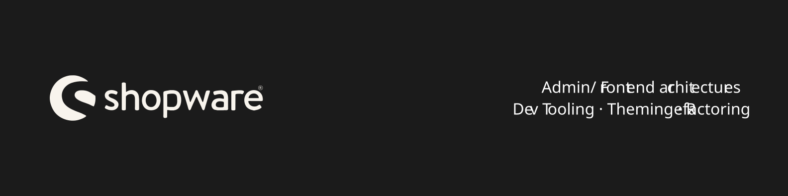

# Shopware 6 Architecture & Theming

Shopware component and theming architecture for administration and frontend views.

## Table of Contents

- [About](#about)
- [When to use this](#when-to-use-this)
- [Who might benefit](#who-might-benefit)
- [Get in touch](#get-in-touch)
- [Disclaimer](#disclaimer)

---

## About

Exemplary, selective code demonstrating Shopware 6 feature potential.
The examples showcase possibilities and code quality achievable with a custom backend architecture.

*This repository is a placeholder for a commercial product. Get in touch for details.*

### Goals

- Save time and budget: Ship code faster, with fewer bugs, less testing, and improved developer experience
- Quickly craft portable, reusable, stable components for any shop
- Stabilize code generation in large-scale applications with many features and components

---

## When to use this

### Architecture benefits

- Shopware system standard is needlessly verbose, repetitive, and error-prone
- Files and content are hard to read, even though scoping and encapsulation eliminate the need for full qualification
  - e.g., the full component name is repeated across all files and selectors in various formats
- Naming or renaming features across all written variants is error-prone and time-consuming
- CLI defaults suit simple solutions, yet complex features are often needed
- Copy-pasting is an easy but flawed solution — now replaced with a robust, practical approach
- Performance improvement, even if modest: Less code to write and load (e.g., CSS)
- Refactoring intent: Architecture is adjustable per individual component (automation-friendly)
- AI workflow cost reduction: Replace search/replace across many files. Copying, pasting, and editing a single file is cheaper and faster every time.

<b>Side notes</b>

The 7-1 CSS architecture is a solid starting point for CSS-only projects.
However, it falls short for large-scale applications with complex features and
third-party integrations that do not follow consistent rules.

When building modules, components, child components, and their variations or overrides,
structure and organization must adapt accordingly.

As a non-standardized approach, it requires onboarding and documentation,
making it best suited for stable, mature teams with well-attuned workflows.

### When not to use

- During an ongoing project with tight budgets or deadlines
- A large application already exists using Shopware Standard or a different architecture
- If the cost of adjustment or refactoring is too high or risky
- Improvements would be negligible (e.g., no large new features expected)
- Teams prefer their current architecture and are productive with it

---

## Who might benefit

Most effective when used in fresh projects intended for large-scale applications.

- **Teams/companies**
  - Looking to enhance team output and reallocate testing resources to productivity
  - Onboarding external staff who work in isolation or under different conditions
  - Hiring for a project and wanting to ensure capability and code quality
- **Solo developers**
  - Working as freelancers or contractors with technical lead
- **AI/Agentic development**
  - Consistency, simplicity, reduced token count, and lower costs
  - Instruct to edit one file, not search/replace across many

---

## Get in touch

Interested in learning more about how this system can improve your
e-commerce application and development workflows?

Let's connect and chat about your project:

---

## Disclaimer

Read on: [Disclaimer](DISCLAIMER.md)
